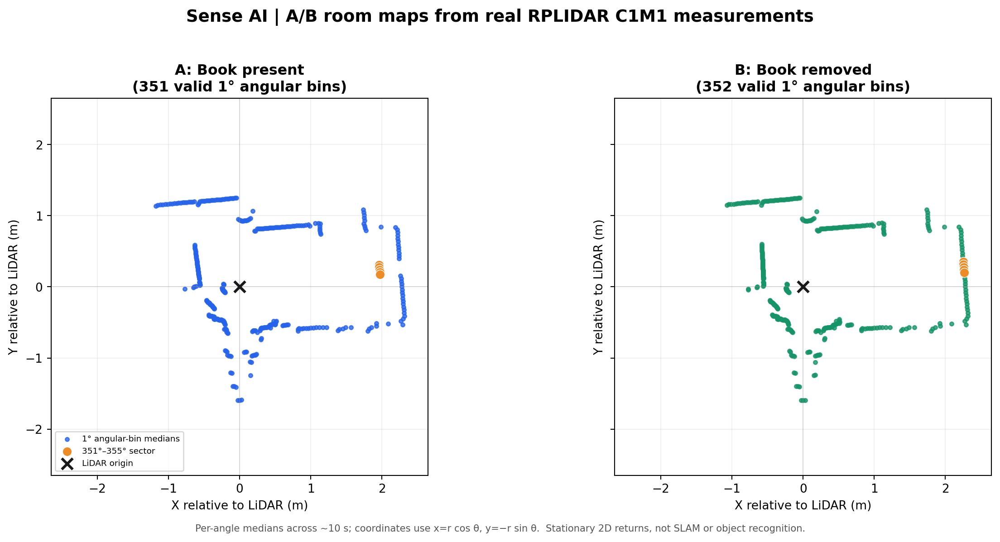
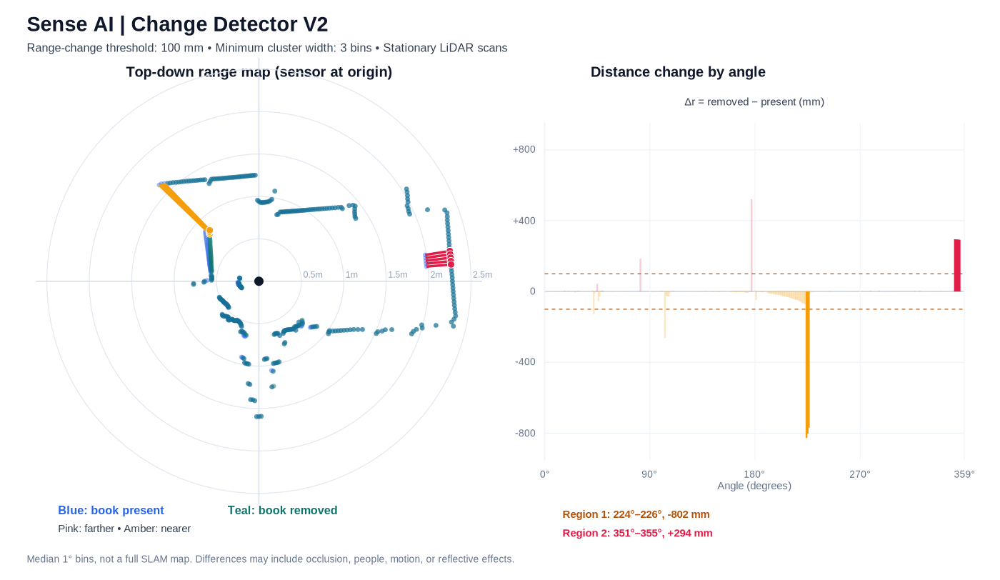

# Sense AI — Stationary LiDAR Mapping & Change Detection

**Personal post-HackMIT development | October 2026**  
**Hardware:** SLAMTEC RPLIDAR C1M1 + USB serial adapter + MacBook  
**Software:** SLAMTEC SDK (`ultra_simple`), Python 3, CSV processing

> This repository documents an experimental LiDAR sensing pipeline. It **does not** implement full SLAM, live autonomous navigation, or visual object identification.

## What works

- Capture angular range readings from an RPLIDAR C1M1 using the official SLAMTEC SDK and a custom Python logger.
- Log sensor angles, distances, quality, host-reception timestamps, and scan information to CSV; use a 120-second warm-up and controlled captures.
- Convert polar measurements to Cartesian coordinates for **stationary 2D point-cloud** visualization.
- Compare two stationary room scans using median positive ranges in 1° angular bins.
- Detect changes with an absolute range-difference threshold, 3-bin spatial-consistency filter, and correct 359°/0° circular grouping.
- Export detected regions as CSV and a 2D/SVG visualization.

## Evidence from the actual experiments

| Test | Observation |
| --- | --- |
| Book present versus removed (~2 m) | Range increase near **351°–355°**; median **+294 mm** (farther surface visible) |
| V2 detection (100 mm threshold, ≥3 bins) | **2** surviving angular clusters: **351°–355°** and unexplained **224°–226°** |
| Threshold sensitivity (150 mm instead of 100 mm) | Same two regions survived filtering |
| Laptop setup change | Near returns changed by **>500 mm** around 169°–171°; both the cover and laptop height changed |
| Laptop on-floor repeat scan | **350/360** comparable angular bins; median absolute difference **1 mm**; **0 clusters** at 100 and 150 mm thresholds with ≥3 bins |
| Range characterization | Mean ranges approximately **495.06, 991.56, 1982.58 mm** for nominal **500, 1000, 2000 mm** references |

Important limitations: the manually established reference uncertainties vary by experiment; angle-based comparison assumes a stationary sensor; an observed change does not automatically identify an object; the unexplained 224°–226° cluster has not been attributed to a physical cause. Individual demonstrations and one no-change repeat test do not establish general detector accuracy or false-alarm rate.

## Results





## Run the existing V2 detector

The sample angular-summary CSV is included, so the analysis works **without an attached LiDAR or additional packages**:

```bash
python3 sense_ai_change_detector_v2.py --threshold-mm 100 --min-bins 3
```

Results are written to `outputs/sense_ai_v2_detected_regions.csv` and `outputs/sense_ai_v2_change_map.svg`.

## Next experiment: estimated locations of changed surfaces

```bash
python3 sense_ai_localize_v1.py --threshold-mm 100 --min-bins 3
```

This experimental step estimates local LiDAR-frame `(x, y)` positions from the **nearer observed surface** in a changed angular cluster. The inferred angular footprint is an arc-length approximation, **not** an independently validated object width. Its coordinates are not room-aligned until physical sensor orientation is verified.

## Data acquisition / prerequisites

The included `sense_ai_logger_v3.py` is specific to the original macOS experimental environment: it expects the built SLAMTEC SDK `ultra_simple` example under `~/EE-Build-Lab/Sense-AI/rplidar_sdk/output/Darwin/Release/`. The SDK binary and USB drivers are **not** redistributed here. The host serial port and local paths may need editing. This logger uses only Python standard-library modules.

For the SDK, obtain the software and device documentation from SLAMTEC directly. Avoid staring into the laser aperture and keep the sensor mechanically stable during capture.

## Repository structure

```text
README.md
sense_ai_logger_v3.py                 # experimental macOS SDK logger
sense_ai_change_detector_v2.py        # verified post-processing algorithm
sense_ai_localize_v1.py               # next experimental milestone
sense_ai_room_ab_angular_summary.csv  # small, reproducible analysis sample
figures/                              # plots from actual recordings
docs/experiments.md                   # observations and limitations
docs/resume_bullets.md                 # accurate resume wording
```

## Background and attribution

The original **HackMIT 2026** project explored an inventory-tracking/home-assistant concept using RPLIDAR, ESP32-CAM, and ESP32-S3-BOX-3, but the final hackathon demo relied on a software simulation; full integrated live sensor mapping or object recognition was **not** completed at the event. The experiments and results here are explicitly **post-hackathon independent development**. Separate these phases in a portfolio or resume.
